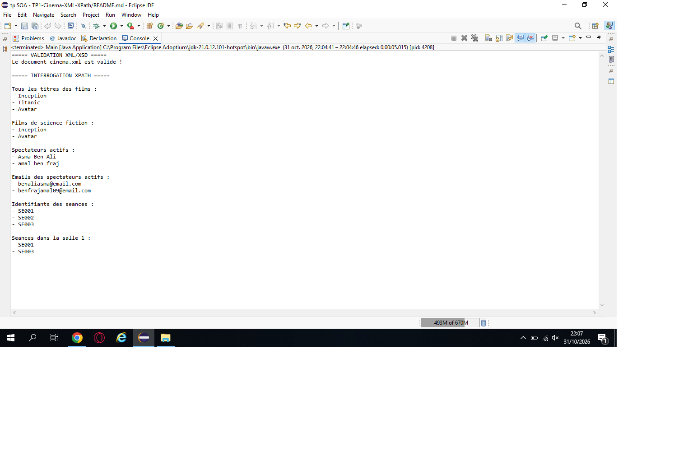

# TP1 – Modélisation XML et interrogation XPath avec Maven en Java

## Matière

Architecture SOA et services web

## Objectif du TP

L'objectif de ce travail pratique est de modéliser un domaine réel en XML, de créer un schéma XSD pour valider la structure des données et d'utiliser XPath en Java pour interroger le document XML.

## Domaine choisi : le cinéma

Le domaine choisi pour ce projet est le cinéma.

Les principales entités utilisées sont :

- Les films
- Les spectateurs
- Les séances

Chaque film possède un identifiant, un genre, une année, un titre, un réalisateur et une durée.

Chaque spectateur possède un identifiant, un statut actif ou inactif, un nom et une adresse e-mail.

Chaque séance possède un identifiant, une référence vers un film, une salle, une durée, une date et une heure.

## Structure du projet

Le projet contient les fichiers suivants :

- `pom.xml` : fichier de configuration du projet Maven.
- `cinema.xml` : contient les données du cinéma.
- `cinema.xsd` : définit les règles et la structure que le fichier XML doit respecter.
- `Main.java` : contient le programme Java permettant de valider le XML et d'effectuer les requêtes XPath.

## Validation XML/XSD

La première fonctionnalité du programme consiste à vérifier que le document `cinema.xml` respecte les règles définies dans le fichier `cinema.xsd`.

La validation est réalisée en Java à l'aide des classes suivantes :

- `SchemaFactory`
- `Schema`
- `Validator`

Lorsque le document XML respecte toutes les règles du schéma XSD, le programme affiche :

Le document cinema.xml est valide !

## Interrogation XPath

La deuxième fonctionnalité consiste à interroger le document XML à l'aide de XPath.

Les requêtes XPath utilisées sont :

### 1. Tous les titres des films

`//film/titre`

Cette requête permet de récupérer les titres de tous les films.

### 2. Les films de science-fiction

`//film[@genre='Science-fiction']/titre`

Cette requête sélectionne les titres des films dont le genre est Science-fiction.

### 3. Les spectateurs actifs

`//spectateur[@actif='true']/nom`

Cette requête récupère les noms des spectateurs ayant le statut actif.

### 4. Les e-mails des spectateurs actifs

`//spectateur[@actif='true']/email`

Cette requête récupère les adresses e-mail des spectateurs actifs.

### 5. Les identifiants des séances

`//seance/@id`

Cette requête permet de récupérer les identifiants de toutes les séances.

### 6. Les séances dans la salle 1

`//seance[salle=1]/@id`

Cette requête sélectionne les identifiants des séances qui se déroulent dans la salle numéro 1.

## Résultat obtenu

Le programme réalise deux fonctionnalités principales :

1. La validation du fichier XML avec le schéma XSD.
2. L'interrogation du fichier XML avec plusieurs requêtes XPath.

Lorsque le fichier XML est valide, le programme affiche un message confirmant la validation, puis affiche les résultats des différentes requêtes XPath.

## Conclusion

Ce TP a permis de comprendre les rôles complémentaires de XML, XSD et XPath.

- XML est utilisé pour stocker et organiser les données.
- XSD est utilisé pour définir et vérifier la structure et les types de données du document XML.
- XPath est utilisé pour rechercher et extraire des informations précises dans le document XML.

Java permet d'utiliser ces différentes technologies afin de valider et d'interroger les données du domaine du cinéma.